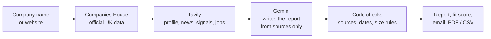

# WhyNow

**Know the fit. Know the moment.**

WhyNow is an AI account research agent for SDRs and sales teams. Type a UK company name or website, and in about 45 seconds you get a sourced research report, an ICP fit score with reasons, the reasons to reach out *now*, who to contact, and a short outreach email. Every fact links to where it came from.

**[▶ Live demo](#live-demo)** (coming soon) · [How it works](docs/how-it-works.md) · Built by [Ved Prakash Pandey](https://www.linkedin.com/in/ved-prakash-pandey-954493202/)


## Why it exists
SDRs often spend 20–30 minutes researching each account before they can write a good first message. WhyNow does the same research in **about 45 seconds** and shows its sources, so a rep can check anything in one click instead of trusting an AI's guess.

| | |
|---|---|
| ⏱️ **About 45s per report** | Average of 17 live reports on real UK companies (median 41s) |
| 🎯 **15 of 15 matched** | The right company or group on Companies House, in a live test of 15 UK B2B companies |
| 🔗 **0 unsourced claims** | Code removes any AI claim that doesn't cite a fetched source |

## What you get
- **Who they are:** a short overview with key numbers (headcount and trend, founded, funding, revenue), plus directors, owners, competitors and open roles
- **If they fit:** an ICP fit score from 1 to 10, with 2–3 reasons
- **Why reach out now:** recent buying signals such as sales hiring, funding, new leaders or expansion, each with how long ago it happened
- **Who to contact:** a suggested role, with a one-click LinkedIn people search
- **Outreach:** an email under 120 words that opens with a real trigger, plus a LinkedIn connection note and a two-line call opener, written for the Head of Sales, Head of RevOps or Founder / CEO
- **Exports:** a printable PDF report and a CRM-ready CSV row
- **Research a list:** upload a CSV of up to 10 companies and get them ranked by fit

<details><summary><b>See a full sample report</b> (Paddle)</summary>


</details>

<details><summary><b>See the outreach</b> (email, LinkedIn note and call opener)</summary>


</details>

## How it works

1. **Find the right company** on Companies House. Brands registered under another name (e.g. Brandwatch is registered as RUNTIME COLLECTIVE LIMITED) are found from the company's own website or profile, never guessed.
2. **Research** the company profile, website, recent news, buying signals and job ads with Tavily. Results older than 6 months are left out.
3. **Write the report** with Gemini, which sees *only* the fetched sources and must cite them (S1, S2…).
4. **Check the AI's work in code:** claims without a valid source are removed, old events can't count as reasons to reach out, company-size rules cap the score, and every change is listed under "Behind the scenes".

More detail: [docs/how-it-works.md](docs/how-it-works.md).

## Results from a live test (19 Nov 2026)
18 real searches through the same steps as the app: 15 UK B2B companies of different sizes and sectors, plus 3 tricky ones. Run with [scripts/live_benchmark.py](scripts/live_benchmark.py) (live: about 11 Tavily credits and 1 Gemini request per company). Times are for the first, uncached run: the search, then research and the report.

| Typed | Sector · size | Matched on Companies House | Correct? | Fit | Reasons to reach out | Wrong or unsourced facts | Time |
|---|---|---|---|---|---|---|---|
| Sage Group | Accounting software · large | THE SAGE GROUP PLC. | ✅ | 3 | 1 | None | 37s |
| rightmove.co.uk | Property portal · large | RIGHTMOVE GROUP LIMITED | ✅ (operating company) | 4 | 1 | None | 50s |
| autotrader.co.uk | Car marketplace · large | AUTOTRADER LIMITED | ✅ | 3 | 1 | None | 50s |
| gocardless.com | Payments · mid | GOCARDLESS LTD | ✅ | 8 | 1 | None | 43s |
| Thought Machine | Banking software · mid | THOUGHT MACHINE GROUP LIMITED | ✅ | 7 | 0 | None | 42s |
| tide.co | Business banking · mid | TIDE PLATFORM LTD | ✅ | 8 | 3 | None | 39s |
| onfido.com | Identity checks · mid | ONFIDO HOLDINGS LIMITED | ⚠️ parent company | 7 | 0 | Website shown as entrust.com (fixed) | 40s |
| Featurespace | Fraud prevention · mid | FEATURESPACE LIMITED | ✅ | 5 | 1 | Website was a bit.ly link (fixed) | 46s |
| peak.ai | AI software · small–mid | PEAK AI LIMITED | ✅ | 7 | 0 | None | 35s |
| huboo.com | E-commerce fulfilment · mid | HUBOO TECH LIMITED | ✅ | 4 | 1 | None | 48s |
| mention-me.com | Referral marketing · small | MENTION ME LIMITED | ✅ | 6 | 0 | None | 43s |
| juro.com | Legal tech · small | JURO ONLINE LIMITED | ✅ | 6 | 0 | Missed a sales job ad (fixed: now 1) | 40s |
| hyperexponential.com | Insurance software · small–mid | HYPEREXPONENTIAL LTD | ✅ | 9 | 1 | None | 43s |
| ravelin.com | Fraud detection · small | RAVELIN TECHNOLOGY LTD | ✅ | 8 | 1 | None | 48s |
| Ometria | Retail marketing · small | OMETRIA LTD | ✅ | 6 | 0 | Missed a sales job ad (fixed: now 1) | 44s |
| **Brandwatch** (brand name) | Social intelligence | RUNTIME COLLECTIVE LIMITED, from a public source | ✅ | 9 | 1 | Website had a page path (fixed) | 131s (one slow Tavily reply) |
| **Thougth Machine** (misspelt) | n/a | None picked; a clear message instead | ✅ no wrong match | n/a | n/a | n/a | 1s |
| **Cazoo** (closed company) | Car retail | MOTORS.CO.UK LIMITED, the brand's current owner (the old Cazoo companies are closed) | ✅ | 3 | 2 | Old Cazoo profile facts shown against the new owner (fixed: a note now says so) | 37s |

- **Matching:** all 15 main companies went to the right company or group, and 14 of 15 to the exact trading company. No tricky search produced a wrong match.
- **Facts:** no claim without a source reached a report (code removed 0). Every flagged problem came from a public source, not the AI, and all are now fixed.
- **Speed:** **about 45 seconds per report on average** (median 41s; 32s to 121s), or about 48s including the company search. That compares with the 20–30 minutes an SDR typically spends researching an account by hand.
- **Fixed after this test:**
  - Typed websites like `tide.co`, `ravelin.com` and `huboo.com` first matched the wrong company. They now check the website's own footer or terms for the registered name when Companies House alone can't tell.
  - A website now counts as an exact name match ("gocardless.com" = GOCARDLESS LTD), so that paid check isn't run for nothing.
  - Sales job ads the AI skipped now become a "Hiring for sales" reason, linked to the ads.
  - The website the user typed wins over the profile card's website.
  - Link shorteners and page paths are never shown as a company's website.
  - When a brand now belongs to another company (Cazoo → MOTORS.CO.UK LIMITED), the report says so at the top, and the founded date comes from Companies House.
- **Credits:** run 1 used 197 Tavily credits and 17 Gemini requests. Re-testing the 5 fixed companies used 7 credits and 5 requests, thanks to the 24-hour cache.

## Tech stack
| Part | Tool |
|---|---|
| App | Python 3.13 · Streamlit, with a custom dark theme in CSS |
| Company data | [Companies House API](https://developer.company-information.service.gov.uk/) (free, official UK register) |
| News, signals, job ads | [Tavily](https://tavily.com/) search API |
| AI | Google Gemini (gemini-3.6-flash, with 3 backup models), structured answers checked with Pydantic |
| Exports | fpdf2 (PDF) and Python's csv module |
| Tests | pytest: 410+ tests with fake API replies, so they're free and need no keys |

## Run it locally
You need Python 3.13 and three API keys: Companies House (free), Tavily (free tier available) and Gemini.

1. **Get the code**
   ```bash
   git clone https://github.com/ved-pandey01/whynow.git
   cd whynow
   ```
2. **Install**
   ```bash
   python3.13 -m venv .venv
   .venv/bin/pip install -r requirements.txt
   ```
3. **Add your keys:** copy `.env.example` to `.env` and paste your keys after each `=`. The `.env` file is git-ignored and never uploaded.
   ```bash
   cp .env.example .env
   ```
4. **Start the app**
   ```bash
   .venv/bin/streamlit run app.py
   ```
   It opens at http://localhost:8501. Click **See a sample report** to try it with no API calls.
5. **Run the tests** (free, no keys needed)
   ```bash
   .venv/bin/python -m pytest
   ```

To change what you're selling, the ICP or the limits, edit [settings.py](settings.py).

## Running costs and safety
- **Daily limits:** 2 live searches per visitor and 30 in total per day. The sample report and any company researched in the last 24 hours are free.
- **Caches:** Companies House data for 7 days, Tavily results and finished reports for 24 hours, so nothing is paid for twice.
- **One AI request** per report, and one for all the outreach.
- **Owner mode** (with `OWNER_PASSWORD` in `.env` and `?owner=1` in the address) removes the limit and shows "Research a list" and usage totals.
- **Secrets:** API keys live only in `.env`, which is never committed. Nothing logs keys.
- **Friendly errors:** if a company isn't found or a service is down, the page says what happened and what to try next. It never crashes.

## Live demo
A hosted version is coming soon. Until then, follow [Run it locally](#run-it-locally); the sample report works without any keys.

## Part of a pair
WhyNow is the outbound partner to my [Inbound Lead Engine](https://github.com/ved-pandey01/inbound-lead-engine) (n8n).
