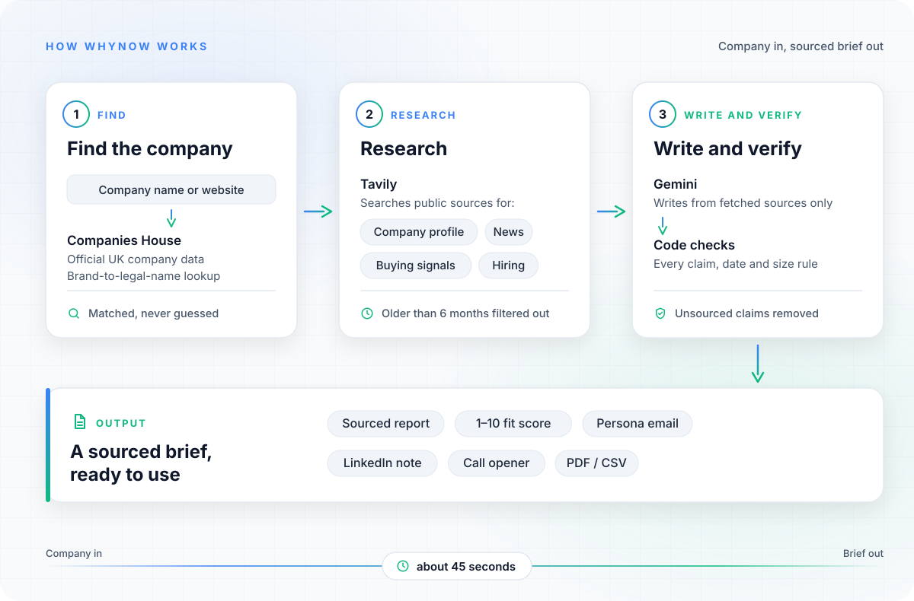
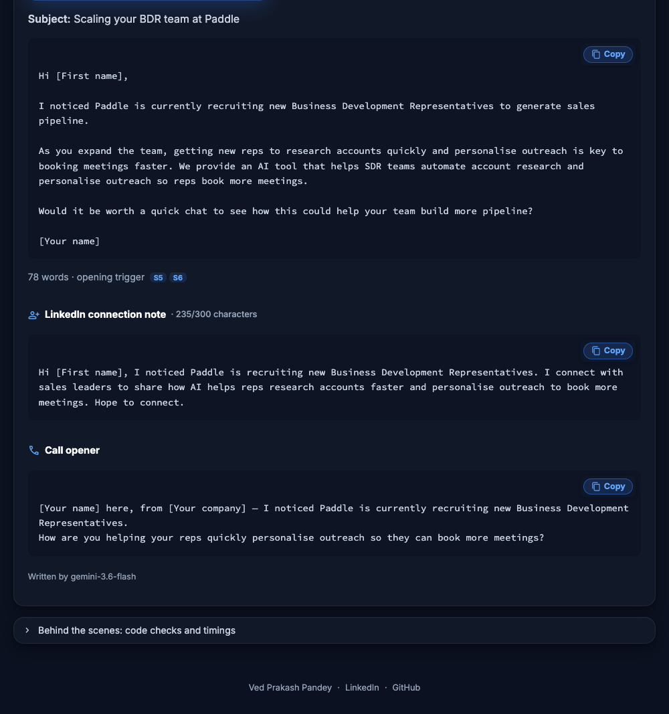

# WhyNow

**Know the fit. Know the moment.**

Sales reps lose time researching accounts by hand, then send outreach that is generic or badly timed. WhyNow researches any UK company from official and public sources, scores its fit and finds a reason to reach out now. The result is a sourced account brief and a ready-to-send email in about 45 seconds.


**[Live demo](#live-demo)** (coming soon) · **[Sample report](#sample-report)** · [How it works in detail](docs/how-it-works.md)


## Why it matters
- **Timing.** Outreach lands best when something has just changed. WhyNow surfaces recent sales hiring, funding, new leaders and expansion, and ignores anything older than 6 months.
- **Relevance.** Every email opens with a specific, sourced fact about that company and is written for the person's role.
- **Trust.** Every fact links to its source, so a rep can check it in one click before using it.

## Key features
**Research**
- Official company data from Companies House: status, industry, directors and owners.
- Company profile, recent news, buying signals and job ads from public sources.
- Finds brands registered under another name, such as Brandwatch, which is registered as RUNTIME COLLECTIVE LIMITED.
- Finds any registered company, small or large: search by name, website or 8-digit company number, with spelling suggestions ("Gregs" suggests GREGGS PLC).
- Small companies with no news still get a report from Companies House data: directors, owners, industry, registered office and filing history.

**Scoring**
- ICP fit score from 1 to 10, with 2 to 3 sourced reasons.
- Company-size rules applied in code, not left to the AI.
- A suggested role to contact, with a LinkedIn people search.

**Outreach**
- Email under 120 words, opening with a cited trigger.
- LinkedIn connection note and a two-line call opener from the same request.
- Written for the Head of Sales, Head of RevOps or Founder / CEO.

**Export**
- Printable PDF report with clickable sources.
- CRM-ready CSV row.
- Research a list: upload up to 10 companies and get them ranked by fit.

**Reliability**
- A clear message for every failure: company not found, a service down, no internet or a bad file.
- If news search fails, the report still builds from Companies House data.

**Cost control**
- 2 live searches per visitor and 30 in total per day.
- The sample report and anything researched in the last 24 hours are free.

## Built for trust
- **Every claim is sourced.** The AI sees only the data WhyNow fetched and must cite it (S1, S2 and so on).
- **AI output is checked in code.** Any claim without a valid source is removed, and every change is listed under "Behind the scenes".
- **Old signals are filtered out.** Events older than 6 months never count as a reason to reach out.
- **Honest when data isn't found.** The report says "not found" rather than guessing.

## How it works
<picture>
  <source media="(prefers-color-scheme: dark)" srcset="assets/diagrams/how-it-works-dark.svg">
  <source media="(prefers-color-scheme: light)" srcset="assets/diagrams/how-it-works-light.svg">
  
</picture>

1. Find the right company on Companies House.
2. Research the company profile, website, news, signals and job ads.
3. Gemini writes the report from those sources only.
4. Code checks the result before anything is shown.

## Sample report
A real report for Paddle, saved from a live run.

<details><summary><b>See the full report</b></summary>


</details>

<details><summary><b>See the outreach</b> (email, LinkedIn note and call opener)</summary>


</details>

## Engineering highlights
- **Model fallbacks.** gemini-3.6-flash is the main model, with 3 backup models. Each is tried once, with no hidden retries.
- **Caching.** Companies House data is kept for 7 days, and search results and finished reports for 24 hours, so nothing is paid for twice.
- **Rate limits.** Daily limits are counted on the server, so a page refresh doesn't reset them.
- **454 automated tests.** They use fake API replies, so they run in seconds, cost nothing and need no keys.
- **Live test on 18 companies.** Real searches through the full pipeline, with the error patterns found and fixed (see Results).
- **Secrets never committed.** API keys live only in a git-ignored `.env` file, and the full Git history was scanned before publishing.

## Results
**15 of 15 companies matched, 0 unsourced claims, about 45 seconds per report.**

A live test on 19 Nov 2026: 15 UK B2B companies of different sizes and sectors, plus 3 tricky searches (a brand name, a misspelling and a closed company). Times are from the first, uncached run and include the company search.

| Typed | Sector, size | Matched on Companies House | Correct? | Fit | Reasons to reach out | Wrong or unsourced facts | Time |
|---|---|---|---|---|---|---|---|
| Sage Group | Accounting software, large | THE SAGE GROUP PLC. | Yes | 3 | 1 | None | 37s |
| rightmove.co.uk | Property portal, large | RIGHTMOVE GROUP LIMITED | Yes (operating company) | 4 | 1 | None | 50s |
| autotrader.co.uk | Car marketplace, large | AUTOTRADER LIMITED | Yes | 3 | 1 | None | 50s |
| gocardless.com | Payments, mid | GOCARDLESS LTD | Yes | 8 | 1 | None | 43s |
| Thought Machine | Banking software, mid | THOUGHT MACHINE GROUP LIMITED | Yes | 7 | 0 | None | 42s |
| tide.co | Business banking, mid | TIDE PLATFORM LTD | Yes | 8 | 3 | None | 39s |
| onfido.com | Identity checks, mid | ONFIDO HOLDINGS LIMITED | Parent company | 7 | 0 | Website shown as entrust.com (fixed) | 40s |
| Featurespace | Fraud prevention, mid | FEATURESPACE LIMITED | Yes | 5 | 1 | Website was a bit.ly link (fixed) | 46s |
| peak.ai | AI software, small to mid | PEAK AI LIMITED | Yes | 7 | 0 | None | 35s |
| huboo.com | E-commerce fulfilment, mid | HUBOO TECH LIMITED | Yes | 4 | 1 | None | 48s |
| mention-me.com | Referral marketing, small | MENTION ME LIMITED | Yes | 6 | 0 | None | 43s |
| juro.com | Legal tech, small | JURO ONLINE LIMITED | Yes | 6 | 0 | Missed a sales job ad (fixed: now 1) | 40s |
| hyperexponential.com | Insurance software, small to mid | HYPEREXPONENTIAL LTD | Yes | 9 | 1 | None | 43s |
| ravelin.com | Fraud detection, small | RAVELIN TECHNOLOGY LTD | Yes | 8 | 1 | None | 48s |
| Ometria | Retail marketing, small | OMETRIA LTD | Yes | 6 | 0 | Missed a sales job ad (fixed: now 1) | 44s |
| **Brandwatch** (brand name) | Social intelligence | RUNTIME COLLECTIVE LIMITED, from a public source | Yes | 9 | 1 | Website had a page path (fixed) | 131s (one slow search reply) |
| **Thougth Machine** (misspelt) | n/a | None picked; a clear message instead | Yes, no wrong match | n/a | n/a | n/a | 1s |
| **Cazoo** (closed company) | Car retail | MOTORS.CO.UK LIMITED, the brand's current owner | Yes | 3 | 2 | Old Cazoo profile facts shown against the new owner (fixed: a note now says so) | 37s |

- **Matching.** All 15 main companies went to the right company or group, and 14 of 15 to the exact trading company. No tricky search produced a wrong match.
- **Facts.** No claim without a source reached a report. Every flagged problem came from a public source, not the AI, and all are now fixed.
- **Speed.** About 45 seconds per report on average (median 41s, range 32s to 121s), or about 48s including the company search. An SDR typically spends 20 to 30 minutes researching an account by hand.
- **Fixed after the test.** Website matching now checks the company's own site for its registered name, skipped sales job ads become a hiring signal, and a note shows when a brand has a new owner.

## Tech stack
| Part | Tool |
|---|---|
| App | Python 3.13, Streamlit with a custom dark theme |
| Company data | [Companies House API](https://developer.company-information.service.gov.uk/), the official UK register |
| News, signals, job ads | [Tavily](https://tavily.com/) search API |
| AI | Google Gemini, with structured answers checked by Pydantic |
| Exports | fpdf2 for PDF, Python's csv module for CSV |
| Tests | pytest, 454 tests |

## Run it locally
You need Python 3.13 and three API keys: Companies House (free), Tavily (free tier available) and Gemini.

1. **Get the code**
   ```bash
   git clone https://github.com/ved-pandey01/whynow.git
   cd whynow
   ```
2. **Install**
   ```bash
   python3.13 -m venv .venv
   .venv/bin/pip install -r requirements.txt
   ```
3. **Add your keys.** Copy `.env.example` to `.env` and paste your keys after each `=`. The `.env` file is git-ignored and never uploaded.
   ```bash
   cp .env.example .env
   ```
4. **Start the app**
   ```bash
   .venv/bin/streamlit run app.py
   ```
   It opens at http://localhost:8501. Click **See a sample report** to try it with no API calls.
5. **Run the tests** (free, no keys needed)
   ```bash
   .venv/bin/python -m pytest
   ```

To change what you're selling, the ICP or the limits, edit [whynow/settings.py](whynow/settings.py).

## Live demo
A hosted version is coming soon. Until then, follow [Run it locally](#run-it-locally). The sample report works without any API keys.

### Deploy to Streamlit Community Cloud
1. On [share.streamlit.io](https://share.streamlit.io), choose **Create app**, then this repository, branch `main` and main file `app.py`.
2. Under **Advanced settings**, choose Python 3.13 and paste your secrets in the format of [.streamlit/secrets.toml.example](.streamlit/secrets.toml.example).
3. Deploy. Keys and the owner password are read from Streamlit's secrets when deployed and from `.env` locally ([whynow/config.py](whynow/config.py)). Caches and usage logs create their own folders, so caching and the daily limits work online. They reset when the app restarts.

## Roadmap
- **HubSpot push.** Send the report and email straight to the CRM.
- **Contact finder.** Find the right person at the company, not just the role.
- **More markets.** Company registers beyond the UK.

## About the builder
Built by **Ved Prakash Pandey**, a Business Development professional moving into GTM Engineering.

[LinkedIn](https://www.linkedin.com/in/ved-prakash-pandey-954493202/) · [GitHub](https://github.com/ved-pandey01)

WhyNow is the outbound partner to my [Inbound Lead Engine](https://github.com/ved-pandey01/inbound-lead-engine), built in n8n.
