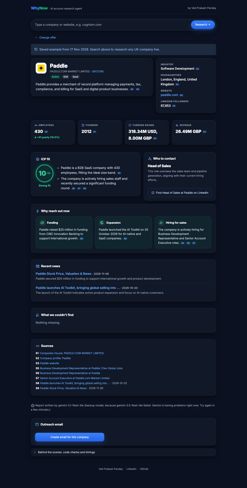

# WhyNow

**Know the fit. Know the moment.**

WhyNow is an AI account research agent for SDRs and sales teams. Type any UK company and, in under a minute, see:
- **who they are:** a short, sourced snapshot with key stats (headcount and trend, founded, funding, revenue)
- **if they fit:** an ICP fit score from 1 to 10, colour-coded, with 2–3 reasons
- **why to reach out now:** buying signals such as sales hiring, funding, new leaders or expansion
- **who to contact:** a suggested role, plus a one-click LinkedIn people search
- **an outreach email:** under 120 words, opening with a real trigger, written only when you ask


<details><summary>See a full sample report (Paddle, saved 17 Nov 2026)</summary>


</details>

**Why:** SDRs often spend 20–30 minutes researching each account. WhyNow aims to cut that to under a minute, and every fact links to its source.

> 🚧 Work in progress: Stage 1 is being built.

## Tech stack
Python · Streamlit (with custom CSS) · Companies House API · Tavily · Gemini · Pydantic · pytest

## Setup
*(Full setup steps coming as features are added.)*

1. Copy `.env.example` to `.env` and add your API keys.
2. Install packages: `pip install -r requirements.txt`

## Run the web page
```
.venv/bin/streamlit run app.py
```
Your browser opens at http://localhost:8501. Then:
1. Type a company name or website in the search bar and press **Research →** (or Enter). What you're selling is pre-filled from [settings.py](settings.py). Open the small **Change offer** link to edit it, because WhyNow uses it to score the fit and write your email.
   - Or click one of the **Try:** chips under the search bar (Cognism, Darktrace, Paddle). It searches by the company's website and goes straight to the report. The chips are set in `TRY_COMPANIES` in settings.py. The first click on each costs about 10 Tavily credits, then it's cached for 6 hours.
2. Pick the right company. Each Companies House match is a small card showing its industry, size, founded year and city. The biggest companies come first. You get a warning if none of them is a close match.
3. Click **Research this company** (usually 20–45 seconds). While it runs, a card ticks off the live steps: finding the company on Companies House, reading recent news, checking reasons to reach out, scoring the fit and writing the report. The report shows:
   - a banner with the logo, a one-line summary, and a profile card (industry, HQ, website, LinkedIn followers)
   - key stat tiles (if funding is reported in more than one currency, the first is shown as the total and the others in small grey text), and the fit score as a colour-coded badge (green 7–10, amber 4–6, red 1–3)
   - who to contact, "Why reach out now" tiles with icons and how recent each one is (e.g. "Funding · 3 weeks ago", worked out from the source's own date; undated sources such as many job adverts show no age), recent news, what we couldn't find, and sources

   Every small `S1`-style tag links to its source.
4. Use **Download PDF** (a clean, printable report with the WhyNow logo and every source as a clickable link) or **Download CSV** (one CRM-ready row: company, company number, website, employees, fit score, top reasons to reach out, email subject, email body, report date) at the top of any report. Both include the email once it's been created.
5. Click **Create email for this company** to write the email, then **Copy** it. For scores of 3 or under, a note says it's probably not worth contacting.
6. Open "Behind the scenes" to see what code changed in the AI's answer and how long each step took.
7. To start again, click the **WhyNow** logo in the top bar or **← Back to home** above the report. Both clear the current report.

**See a sample report:** on the landing page, click the **Example report** card (a real result for Paddle, saved 17 Nov 2026) or the **See a sample report** button. You can also link straight to it with `http://localhost:8501/?sample=1`. It uses no API calls and needs no keys. To refresh it: `.venv/bin/python -m scripts.save_sample`. The research is saved first in `.cache/` (git-ignored), so if the AI step fails, running it again costs no Tavily credits.

Results are cached: looking up the same company again within 6 hours costs no API credits (all the steps tick at once). The cache is our own small store in [app.py](app.py), so the live steps can still be shown while a new report is made. Stop the app with `Ctrl + C` in the terminal.

## Downloads
- [exports.py](exports.py) builds the CSV (Python's own `csv` module) and the PDF ([fpdf2](https://py-pdf.github.io/fpdf2/)), using only what's already in the report.
- The PDF uses the Inter font in [assets/fonts](assets/fonts) (SIL Open Font Licence, included), so £, € and dashes print properly.

## Design
- Our own look in [ui/style.css](ui/style.css): a premium dark theme with royal blue, emerald and an amber typing line, the Inter font, and dark cards with soft shadows. The landing page has a two-column hero (the WhyNow title, "Know the fit. Know the moment.", an animated "Because…" line and a Google-style search bar on the left; a clickable example report on the right), a subtle grid and line-chart background, and a "Built by Ved Prakash Pandey" pill linking to LinkedIn. The layout stacks on phones.
- Each part of the page is a small function in [ui/components.py](ui/components.py).
- **Safety:** all text fetched from the internet is escaped before it goes on the page, and links only allow http(s), so a web page title can never add code to WhyNow.
- Logos come from the company website's icon (DuckDuckGo's icon service), with the company's initials behind it as a fallback.

## Features so far
- **Companies House lookup** ([sources/uk_companies_house.py](sources/uk_companies_house.py)): finds UK companies by name or website, ranks exact name matches first, and fetches status, industry codes, founded date, address and recently appointed directors. Every fact links to its public Companies House page. Dissolved, insolvent or dormant companies are flagged as "not worth contacting" by code, not by the AI.
  - Try it: `.venv/bin/python -m sources.uk_companies_house "Cognism"`
  - Tip: typing the website (e.g. `paddle.com`) finds the right company more reliably than a short name.
  - **Big companies first:** Companies House lists similar names roughly alphabetically, so for "Howden" the big companies were buried under local firms. The app fetches 100 matches, checks the size of the most likely 25 from the type of accounts they file (group, full, small, micro…), and lists the biggest first. Companies House has no staff counts, so this is a guide. Headcount comes later, from the company profile.
  - Industry (SIC) codes come with their **official meanings** from Companies House, stored in [data/sic_codes.csv](data/sic_codes.csv) (all 731 codes). The AI never has to guess what a code means.

- **News, signals and company card** ([sources/news_tavily.py](sources/news_tavily.py)), using Tavily:
  - **Company card:** headcount and its yearly trend, funding rounds, B2B/SaaS, website. It's only used if one of these confirms it's the company we found: its legal name matches, its website matches, or its name *and* head office city both match Companies House. Each report says how its card was confirmed. If the full name finds no card (e.g. "Sage Group"), one more search tries the short name ("Sage").
  - **News:** recent articles with the company in the headline.
  - **"Why reach out now" signals:** targeted searches for sales hiring, funding, new sales leaders, expansion and layoffs.
  - **Website:** homepage text, so the AI knows what the company actually does.
  - Searches include the website and a topic word from the company card. That stops brands that are ordinary words ("Paddle") pulling in unrelated stories.
  - Try it (about 9 Tavily credits): `.venv/bin/python -m sources.news_tavily "Paddle" "PADDLE.COM MARKET LIMITED" "paddle.com"`

- **AI report** ([report.py](report.py), [ai/](ai/), [models.py](models.py)):
  - Every fetched fact gets a source ID (S1, S2…). Gemini sees **only** those sources and must cite them.
  - **Code checks the AI's work:**
    - claims citing sources we didn't fetch are removed
    - news picks must be real stories from the last 6 months
    - any recent story used as a "Why reach out now" signal also appears under "Recent news", so the two never disagree
    - the email (written only when asked) may only use facts already in the report, must be under 120 words and must open with a cited trigger
    - common American spellings in the email are corrected to British (e.g. personalize → personalise)
    - every change is listed under "Code checks"
  - **Hard rules in code, not AI:**
    - dissolved, insolvent or dormant companies score 1 with no AI call
    - company size bands, using headcount from the company profile:

      | Band | Employees | Effect on score |
      |---|---|---|
      | Best fit | 200–2,000 | no limit |
      | Good fit | 50–199 or 2,001–10,000 | at most 8, with the reason shown |
      | Weak fit | under 50 or over 10,000 | at most 3, plus a "low fit" warning |

    - if headcount isn't found, the AI judges size only from evidence in the sources
  - The AI provider sits behind one function ([ai/provider.py](ai/provider.py)), so swapping Gemini for another model is a settings change.
  - **Backup models:** if the main Gemini model is busy, slow, rate-limited or retired, the request is tried with each model in `GEMINI_FALLBACK_MODELS` in turn, once each (gemini-3.5-flash, then gemini-3.5-flash-lite, then gemini-3.1-flash-lite). Each model has its own free daily allowance (the main model's is only 20 requests a day), so this keeps the app working on busy days. Key problems don't trigger it, because another model wouldn't help. The report and the email each say which model wrote them.
  - Try it (about 9 Tavily credits + 1–2 Gemini requests): `.venv/bin/python -m report "paddle.com"`

- **Time limits** (set in [settings.py](settings.py)):
  - Every service has a limit: Companies House 15s, Tavily 20s per search, Gemini 60s with no hidden retries. A slow service gives a clear message instead of an endless wait.
  - One slow search is skipped with a note, and the rest carry on.
  - After 35 seconds of research, no new searches start, so the report stays near a minute.
  - Each report shows how long each part took.

## Running the tests
```
.venv/bin/python -m pytest
```
The tests use fake API replies, so they're free and need no keys.

## Customising
Edit [settings.py](settings.py) to change the default offer, the ICP (industry, size, fit signals), limits and the AI model. No other code needs to change.

## Part of a pair
This is the outbound partner to my [Inbound Lead Engine](https://github.com/ved-pandey01/inbound-lead-engine) (n8n).
