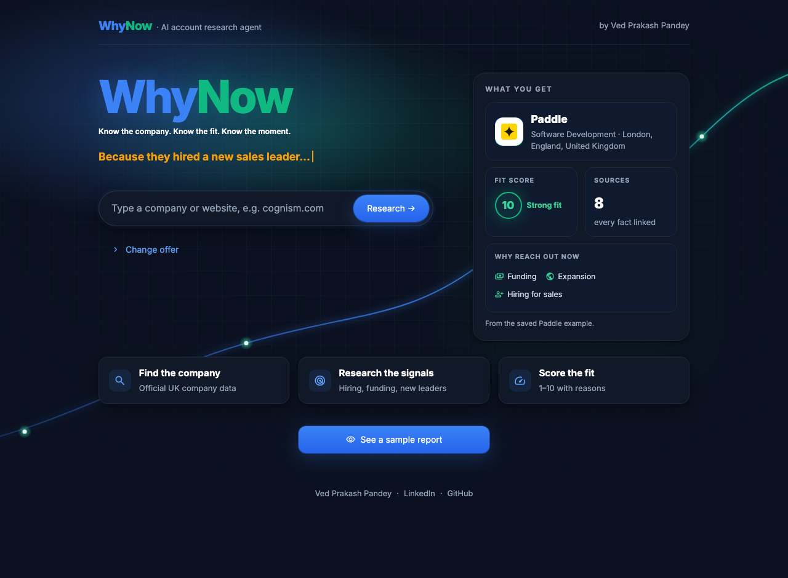

# WhyNow

**Know the fit. Know the moment.**

WhyNow is an AI account research agent for SDRs and sales teams. Type any UK company and, in under a minute, see:
- **who they are:** a short, sourced snapshot with key stats (headcount and trend, founded, funding, revenue)
- **if they fit:** an ICP fit score from 1 to 10, colour-coded, with 2–3 reasons
- **why to reach out now:** buying signals such as sales hiring, funding, new leaders or expansion
- **who to contact:** a suggested role, plus a one-click LinkedIn people search
- **an outreach email:** under 120 words, opening with a real trigger, written only when you ask



<details><summary>See a full sample report (Paddle, saved 17 Nov 2026)</summary>


</details>

**Why:** SDRs often spend 20–30 minutes researching each account. WhyNow aims to cut that to under a minute, and every fact links to its source.

> 🚧 Work in progress: Stage 1 is being built.

## Tech stack
Python · Streamlit (with custom CSS) · Companies House API · Tavily · Gemini · Pydantic · pytest

## Setup
*(Full setup steps coming as features are added.)*

1. Copy `.env.example` to `.env` and add your API keys.
2. Install packages: `pip install -r requirements.txt`

## Run the web page
```
.venv/bin/streamlit run app.py
```
Your browser opens at http://localhost:8501. Then:
1. Type a company name or website in the search bar and press **Research →** (or Enter). What you're selling is pre-filled from [settings.py](settings.py). Open the small **Change offer** link to edit it, because WhyNow uses it to score the fit and write your email.
   - Or click one of the **Try:** chips under the search bar (Cognism, Darktrace, Paddle). Each chip uses a fixed Companies House number, so it always opens the right company, and goes straight to the report. The chips are set in `TRY_COMPANIES` in settings.py. The first click on each costs about 10 Tavily credits, then it's cached for 24 hours. Each counts as a live search (see Running costs).
2. Pick the right company. Each Companies House match is a small card showing its industry, size, founded year and city. The biggest companies come first. You get a warning if none of them is a close match.
3. Click **Research this company** (usually 20–45 seconds). While it runs, a card ticks off the live steps: finding the company on Companies House, reading recent news, checking reasons to reach out, scoring the fit and writing the report. The report shows:
   - a banner with the logo and a 3–4 sentence overview (what they do and their main products, who their customers are, one notable fact), every sentence with its source tag, plus **Read more** (5–7 sentences and a link to the About page or website, only if a source gives it); fewer sentences if the sources don't support more. Next to it, a profile card (industry, HQ, website, LinkedIn followers)
   - **More about [company]** (closed until you open it), with four cards, each saying "Not found in public sources" rather than guessing:
     - **Key people:** current directors from Companies House (role and appointment date), each with a LinkedIn search link (the link only, nothing is scraped)
     - **Owners:** current people or companies with significant control, from Companies House, in plain English (e.g. "owns 75–100% of shares")
     - **Competitors:** up to 4 similar companies named in the company profile, with its source tag
     - **Hiring now:** the number of open roles listed in the company profile, plus example roles from job adverts, sales roles first. This uses the one extra Tavily search per report (about 11 credits in all)
   - key stat tiles (if funding is reported in more than one currency, the first is shown as the total and the others in small grey text), and the fit score as a colour-coded badge (green 7–10, amber 4–6, red 1–3)
   - who to contact, "Why reach out now" tiles with icons and how recent each one is (e.g. "Funding · 3 weeks ago", worked out from the source's own date; undated sources such as many job adverts show no age), recent news, what we couldn't find, and sources

   Every small `S1`-style tag links to its source.
4. Use **Download PDF** (a clean, printable report with the WhyNow logo and every source as a clickable link) or **Download CSV** (one CRM-ready row: company, company number, website, employees, fit score, top reasons to reach out, directors, competitors, email subject, email body, report date) at the top of any report. Both include the email once it's been created.
5. Choose who the email is for (**Head of Sales**, **Head of RevOps** or **Founder / CEO**; Head of Sales by default), then click **Create email for this company** and **Copy** it. Each persona gets its own angle: sales = meetings and pipeline, RevOps = tools and data, founder = growth and cost (set in `EMAIL_PERSONAS` in settings.py). Each email is kept, so switching back is free.
   - The same single AI request also writes a **LinkedIn connection note** (300 characters at most; if it's longer, code cuts it at the last full sentence) and a **2-line call opener**, each with its own Copy button. All three use only facts from the report. For scores of 3 or under, a note says it's probably not worth contacting.
6. Open "Behind the scenes" to see what code changed in the AI's answer and how long each step took.
7. To start again, click the **WhyNow** logo in the top bar or **← Back to home** above the report. Both clear the current report.

**Research a list:** click **Research a list** next to the Try chips and upload a CSV of up to 10 companies (one per row, as names or websites; a `company` or `website` column is used if there is one). WhyNow researches them one by one with the live steps and an overall progress bar, then shows a table ranked by fit score with a **View report** link for each (it opens `?report=<id>` from the 24-hour cache) and **Download all as CSV**. Brands registered under another name are found the same way as a single search (e.g. "Gousto (registered as SCA INVESTMENTS LIMITED)"). A company with no close Companies House match and no registered name in public sources is listed as such, never guessed, and a problem with one company doesn't stop the rest. It warns you first: each company uses about 10 Tavily credits and 1 Gemini request, unless it was researched in the last 24 hours. Research a list is only shown in owner mode. Batch mode doesn't write emails, to save AI quota; open any report to create one. The simple parts (reading the list, ranking) are in [batch.py](batch.py).

**See a sample report:** on the landing page, click the **Example report** card (a real result for Paddle, saved 17 Nov 2026) or the **See a sample report** button. You can also link straight to it with `http://localhost:8501/?sample=1`. It uses no API calls and needs no keys. To refresh it: `.venv/bin/python -m scripts.save_sample`. The research is saved first in `.cache/` (git-ignored), so if the AI step fails, running it again costs no Tavily credits.

Results are cached: looking up the same company again within 24 hours costs no API credits (all the steps tick at once). See **Running costs** below. Stop the app with `Ctrl + C` in the terminal.

## Running costs
WhyNow is built to be cheap to run. Every limit is in the "Running costs" section of [settings.py](settings.py).
- **Daily limits:** each visitor gets **2 live searches a day**, with **30 a day across all visitors**. The sample report and any company researched in the last 24 hours are free and don't count. The count is kept on the server (a hash of the visitor's IP address and browser, never the IP itself), so a refresh doesn't reset it. When the limit is reached, a friendly message offers the sample report instead.
- **When a search counts:** only when research actually starts after **Research this company** (not when the company list is shown). A failed attempt is given back. Visitors see a small grey line under the search bar, e.g. "2 free searches left today" (hidden in owner mode).
- **Picking a company:** **Research this company** is the only way to start research (the name and card aren't clickable). The list then collapses, the live progress card appears under the search bar and the page scrolls to it; when the report is ready the page scrolls to its top. **Choose a different company** above the report brings the list back.
- **Caches** ([cache.py](cache.py), on disk in `.cache/`, so they survive restarts):
  - Companies House replies: 7 days
  - Tavily searches and page reads: 24 hours, so the same Tavily request is never paid for twice
  - finished reports: 24 hours
- **Gemini:** one request per report and one for all the outreach (email, LinkedIn note and call opener). Over-long emails are trimmed by code, not a second request. Each model is tried once before the next backup.
- **Call log** ([usage.py](usage.py)): every Gemini and Tavily call, including cache hits at no cost, is logged to `.usage/`. No keys or search text are logged.
- **Owner mode:** set `OWNER_PASSWORD` in `.env`, then open the page with `?owner=1` at the end of the address (e.g. `localhost:8501/?owner=1`) and use **Owner** under the footer. Without `?owner=1`, the Owner area is never shown. The owner has no daily limit and sees **Research a list** and today's usage totals in "Behind the scenes". With no password set, owner mode is off.

## When something goes wrong
WhyNow never crashes: each problem gets a plain message saying what happened and what to try next.

| Problem | What you see |
|---|---|
| Company not found or misspelled | One short message: "No UK company found…" or "No close match…", ending "Tip: add a location in Filters, or type the company's website." |
| Only dissolved companies match | "No active company found…; only closed ones match. Untick 'Active companies only' in Filters to see them." |
| Industry filter matches nothing | "No industry matches…. Try a simpler word (e.g. software) or a SIC code (e.g. 62012)." |
| Companies House down or slow | "Companies House isn't responding right now. Try again in a few minutes; the sample report still works." |
| Tavily down or out of credits | The report still appears, with a note that news and reasons to reach out are unavailable and the score uses Companies House data only |
| All Gemini models busy | "The AI couldn't write the report right now…", noting that trying again won't use search credits (the research is cached for 24 hours) |
| No internet | "Couldn't connect to the internet. Check your connection and try again." |
| Bad CSV in Research a list | Separate messages for an empty file, a non-CSV file, a file that's too big, or no company names |
| Over-long search | The search box stops at 100 characters |

Anything unexpected shows "Something unexpected went wrong. Please try again in a minute." and prints only the error type (never a key) in the terminal. Each case has a mocked test in [tests/test_errors.py](tests/test_errors.py).

## Downloads
- [exports.py](exports.py) builds the CSV (Python's own `csv` module) and the PDF ([fpdf2](https://py-pdf.github.io/fpdf2/)), using only what's already in the report.
- The PDF uses the Inter font in [assets/fonts](assets/fonts) (SIL Open Font Licence, included), so £, € and dashes print properly.

## Design
- Our own look in [ui/style.css](ui/style.css): a premium dark theme with royal blue, emerald and an amber typing line, the Inter font, and dark cards with soft shadows. The landing page has a two-column hero (the WhyNow title, "Know the fit. Know the moment.", an animated "Because…" line and a Google-style search bar on the left; a clickable example report on the right), a subtle grid and line-chart background, and a "Built by Ved Prakash Pandey" pill linking to LinkedIn. The layout stacks on phones.
- Each part of the page is a small function in [ui/components.py](ui/components.py).
- **Safety:** all text fetched from the internet is escaped before it goes on the page, and links only allow http(s), so a web page title can never add code to WhyNow.
- Logos come from the company website's icon (DuckDuckGo's icon service), with the company's initials behind it as a fallback.

## Features so far
- **Companies House lookup** ([sources/uk_companies_house.py](sources/uk_companies_house.py)): finds UK companies by name or website, ranks exact name matches first, and fetches status, industry codes, founded date, address and recently appointed directors. Every fact links to its public Companies House page. Dissolved, insolvent or dormant companies are flagged as "not worth contacting" by code, not by the AI.
  - Try it: `.venv/bin/python -m sources.uk_companies_house "Cognism"`
  - Tip: typing the website (e.g. `paddle.com`) finds the right company more reliably than a short name.
  - **Filters** (under the search bar, closed by default): **Location** (town or postcode, e.g. Bedford), **Industry** (a SIC code like 62012, or a keyword like "software", turned into SIC codes from the official list) and **Active companies only** (on by default; untick it to see closed companies). With a location or industry, WhyNow uses the free Companies House advanced search.
  - **Cleaner search text:** words after a spaced dash or in brackets are ignored, so "BT Local Business – Home Counties North" searches for "BT Local Business" first (names like "Rolls-Royce" are left alone).
  - **No unrelated names:** a company is only listed if its name shares a main word with the search. Legal, filler and generic words (Ltd, Group, Local, Business, Services…) don't count, so "BT Local Business" only lists names containing "BT".
  - **Brands with a different registered name:** if Companies House has no active close match (e.g. "Gousto" only finds a dissolved takeaway), WhyNow looks for the registered name or company number in public sources: the company's profile page, then its website footer, terms and privacy pages (about 2 Tavily credits). It then looks that up on Companies House, using the company number first, or a name only if it's an exact, active match. The picker shows "Gousto (registered as SCA INVESTMENTS LIMITED)" with a link to where it was found. Nothing is guessed: if no source states it, the page says so. Closed companies are hidden unless "Active companies only" is unticked in Filters.
  - **Main company before deal vehicles:** names with Midco, Bidco, Topco, Holdco (or Finco, Debtco, Propco) are listed after the main company, unless you typed that name (real case: DARKTRACE MIDCO I LIMITED was ranked above DARKTRACE HOLDINGS LIMITED).
  - **Big companies first:** Companies House lists similar names roughly alphabetically, so for "Howden" the big companies were buried under local firms. The app fetches 100 matches, checks the size of the most likely 25 from the type of accounts they file (group, full, small, micro…), and lists the biggest first. Companies House has no staff counts, so this is a guide. Headcount comes later, from the company profile.
  - Industry (SIC) codes come with their **official meanings** from Companies House, stored in [data/sic_codes.csv](data/sic_codes.csv) (all 731 codes). The AI never has to guess what a code means.

- **News, signals and company card** ([sources/news_tavily.py](sources/news_tavily.py)), using Tavily:
  - **Company card:** headcount and its yearly trend, funding rounds, B2B/SaaS, website. It's only used if one of these confirms it's the company we found: its legal name matches, its website matches, or its name *and* head office city both match Companies House. Each report says how its card was confirmed. If the full name finds no card (e.g. "Sage Group"), one more search tries the short name ("Sage").
  - **News:** recent articles with the company in the headline.
  - **"Why reach out now" signals:** targeted searches for sales hiring, funding, new sales leaders, expansion and layoffs.
  - **Website:** homepage text, so the AI knows what the company actually does.
  - Searches include the website and a topic word from the company card. That stops brands that are ordinary words ("Paddle") pulling in unrelated stories.
  - Try it (about 9 Tavily credits): `.venv/bin/python -m sources.news_tavily "Paddle" "PADDLE.COM MARKET LIMITED" "paddle.com"`

- **AI report** ([report.py](report.py), [ai/](ai/), [models.py](models.py)):
  - Every fetched fact gets a source ID (S1, S2…). Gemini sees **only** those sources and must cite them.
  - **Code checks the AI's work:**
    - claims citing sources we didn't fetch are removed
    - news picks must be real stories from the last 6 months
    - any recent story used as a "Why reach out now" signal also appears under "Recent news", so the two never disagree
    - **only events from the last 6 months count:** older dated search results are left out before the AI sees them, so they never become a reason to reach out or affect the score (set by `EVENT_WINDOW_MONTHS` in settings.py)
    - **funding uses the real round date:** a news page dated this month can report an older round. If the company profile dates the last round more than 6 months ago and the signal mentions the same amount, code removes it (real case: Paddle's $25m was debt financing on 17 Aug 2025)
    - each fit reason appears once: when code adds the company-size reason, the AI's own size reason is removed
    - sources are numbered S1, S2, S3… in order with no gaps, and every tag matches
    - the email (written only when asked) may only use facts already in the report, must be under 120 words and must open with a cited trigger
    - common American spellings in the email are corrected to British (e.g. personalize → personalise)
    - every change is listed under "Code checks"
  - **Hard rules in code, not AI:**
    - dissolved, insolvent or dormant companies score 1 with no AI call
    - company size bands, using headcount from the company profile:

      | Band | Employees | Effect on score |
      |---|---|---|
      | Best fit | 200–2,000 | no limit |
      | Good fit | 50–199 or 2,001–10,000 | at most 8, with the reason shown |
      | Weak fit | under 50 or over 10,000 | at most 3, plus a "low fit" warning |

    - if headcount isn't found, the AI judges size only from evidence in the sources
  - The AI provider sits behind one function ([ai/provider.py](ai/provider.py)), so swapping Gemini for another model is a settings change.
  - **Backup models:** if the main Gemini model is busy, slow, rate-limited or retired, the request is tried with each model in `GEMINI_FALLBACK_MODELS` in turn, once each (gemini-3.5-flash, then gemini-3.5-flash-lite, then gemini-3.1-flash-lite). Each model has its own free daily allowance (the main model's is only 20 requests a day), so this keeps the app working on busy days. Key problems don't trigger it, because another model wouldn't help. The report and the email each end with a short "Written by [model]" line; if a backup model was used, the reason is shown under "Behind the scenes".
  - Try it (about 9 Tavily credits + 1–2 Gemini requests): `.venv/bin/python -m report "paddle.com"`

- **Time limits** (set in [settings.py](settings.py)):
  - Every service has a limit: Companies House 15s, Tavily 20s per search, Gemini 60s with no hidden retries. A slow service gives a clear message instead of an endless wait.
  - One slow search is skipped with a note, and the rest carry on.
  - After 35 seconds of research, no new searches start, so the report stays near a minute.
  - Each report shows how long each part took.

## Running the tests
```
.venv/bin/python -m pytest
```
The tests use fake API replies, so they're free and need no keys.

## Customising
Edit [settings.py](settings.py) to change the default offer, the ICP (industry, size, fit signals), limits and the AI model. No other code needs to change.

## Part of a pair
This is the outbound partner to my [Inbound Lead Engine](https://github.com/ved-pandey01/inbound-lead-engine) (n8n).
